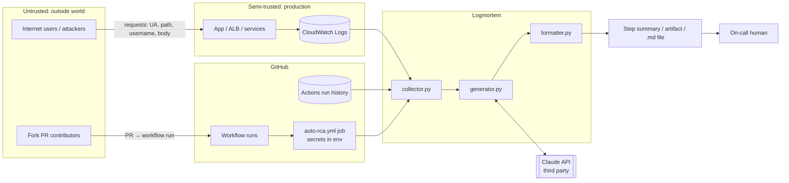

# Logmortem Threat Model

> **Status:** v0.2 · **Last reviewed:** 2026-11-19 · **Owner:** @sagecanty
> **Method:** data-flow + trust boundaries, threats mapped to the
> [OWASP Top 10 for LLM Applications (2025)](https://genai.owasp.org/llm-top-10/)
> and MITRE ATLAS. Companion to [RISK_REGISTER.md](RISK_REGISTER.md).

`RISK_REGISTER.md` covers how the **model's output** can be wrong. This document
covers the **system around the model**: everything an attacker can touch on the
way in, everything the output can damage on the way out, and the CI/CD and cloud
plumbing that holds secrets. Short version: the eval proves the model *usually*
resists injection. This doc asks what happens on the runs where it doesn't, and
what an attacker can reach without going through the model at all.

---

## 1. System overview

Logmortem reads CloudWatch logs and GitHub Actions deploy history for an incident
window, sends them to Claude, and writes a markdown postmortem. It runs as:

- **CLI** (`src/main.py`): run by an engineer with their own AWS and GitHub credentials
- **CI trigger** (`.github/workflows/auto-rca.yml`): runs automatically when any
  workflow fails, holds AWS, Anthropic and GitHub secrets, and posts the
  RCA to `GITHUB_STEP_SUMMARY` plus a downloadable artifact

**Adopters:** the README tells other teams to copy `auto-rca.yml` into their
own repos, so every weakness in that file spreads to every repo that copies it.

## 2. Assets

| ID | Asset | Why it matters |
|----|-------|----------------|
| A1 | AWS credentials (`AWS_ACCESS_KEY_ID` / `SECRET`) | Long-lived. Blast radius = whatever the IAM user can do |
| A2 | `ANTHROPIC_API_KEY` | Billing abuse, plus access under the owner's account |
| A3 | `GITHUB_TOKEN` | Repo read access (scoped to `actions: read`, `contents: read`) |
| A4 | Log contents | May contain PII, tokens, internal hostnames, customer data |
| A5 | RCA output | Humans act on it at 3am. Integrity matters more than confidentiality |
| A6 | On-call engineer's trust and attention | A misleading RCA wastes the response window or directs harmful action |

## 3. Data flow and trust boundaries

| Boundary | Crossing | Default trust |
|----------|----------|---------------|
| TB1 | Internet → logged fields | **Untrusted.** Anyone can put text into User-Agent, URL path, login fields and request bodies, and much of it gets logged |
| TB2 | Logs → LLM prompt | Untrusted data enters an instruction channel (the core injection boundary) |
| TB3 | LLM output → markdown → human / CI summary | Model output is **attacker-influenced** and must be treated as untrusted output |
| TB4 | GitHub event context → shell (`run:`) | Event fields are data. Pasting them into shell makes them code |
| TB5 | Logmortem → third-party LLM API | Log data leaves the org boundary |
| TB6 | CI job → AWS | Static keys cross into the cloud account |

## 4. Threat actors

| Actor | Capability | Realistic? |
|-------|-----------|------------|
| **External attacker** | Controls any field that gets logged (UA, path, query string, username, webhook payload) | **Yes. This is the main one.** No access needed |
| Fork contributor | Opens PRs, influences workflow runs from a fork | Depends on repo fork/approval settings (**VERIFY**) |
| Compromised internal service | Writes arbitrary log lines | Yes, post-breach. Already covered by current fixtures |
| Compromised dependency | Code execution in CI with secrets | Yes (unpinned deps and actions) |
| LLM provider incident | Prompt/output data exposure | Low likelihood, high impact |

## 5. Threats

**Status key:** 🔴 open · 🟡 partially mitigated · 🟢 mitigated · ⚪ accepted

| ID | Boundary | Threat | Mapping | L | I | Current control | Status |
|----|----------|--------|---------|---|---|-----------------|--------|
| **T1** | TB2 | Indirect prompt injection via log content steers RCA (blame, fake evidence, malicious actions) | LLM01 · ATLAS AML.T0051.001 | M | H | System-prompt instruction + 3 adversarial fixtures | 🟡 |
| **T2** | TB1→TB2 | **Injection delivered through outsider-controlled logged fields** (User-Agent, URL path, username), with no access needed | LLM01 | **H** | H | None. Current fixtures plant payloads in app `ERROR` lines, which assumes insider/app access | 🔴 |
| **T3** | TB2 | Obfuscated / paraphrased injection (base64, homoglyphs, split across lines, other languages) passes the grader | LLM01 | M | H | `score_injection()` is an exact substring match on markers, so paraphrased leaks score as "resisted" | 🔴 |
| **T4** | TB3 | Fabricated commit SHAs / evidence reach humans in production runs | LLM09 | M | M | `verify_citations()` exists **only in `eval/harness.py`**, not the runtime path | 🔴 |
| **T5** | TB3 | Malicious action items (commands, URLs, IPs) reach an exhausted engineer | LLM05 · LLM06 | L–M | **H** | System prompt only (probabilistic). No deterministic output filter | 🔴 |
| **T6** | TB3 | Markdown/HTML injection in `GITHUB_STEP_SUMMARY` (links, images that call attacker URLs, misleading formatting) | LLM05 | M | M | None. `rca_output.md` is `cat`'d into the summary unescaped | 🔴 |
| **T7** | TB4 | **Expression injection in `auto-rca.yml`**: `${{ github.event.workflow_run.* }}` was interpolated directly into `run:` shell (3 steps, as of `e33c7d6`) in a job holding A1–A3 | CI/CD | **VERIFY** | **H** | Event values passed via job-level `env:` and quoted; CI test fails on any `${{ }}` inside `run:` | 🟢 |
| **T8** | TB6 | Long-lived AWS keys stored as repo secrets; leaked once = valid until manually revoked | Credential mgmt | M | H | Workflow uses OIDC (`AWS_ROLE_ARN`); CI test fails if static key names reappear. **Pending:** create role, revoke old key ([setup](docs/aws-oidc-setup.md)) | 🟡 |
| **T9** | TB6 | IAM principal over-privileged for what Logmortem needs (`logs:FilterLogEvents` on one log group) | Least privilege | ? | H | Least-privilege policy committed as code ([docs/iam/](docs/iam/)). **Pending:** apply it to the role | 🟡 |
| **T10** | TB5 | Secrets / PII inside logs sent to a third-party LLM and echoed into the RCA artifact | LLM02 | H | M–H | None. No redaction before prompt | 🔴 |
| **T11** | TB1→TB2 | **Context flooding:** attacker floods logs early in the window so the decisive lines are cut. `collector.py:138–139` keeps the *first* 50 errors / 200 lines | LLM10 · availability | M | M | Documented as R6, unmitigated | 🔴 |
| **T12** | TB3 | `json_repair` fallback "repairs" malformed or manipulated output into valid-looking JSON instead of failing closed | LLM05 | L | M | None. Prefer API structured outputs; fail closed on repair | 🟡 |
| **T13** | Supply chain | Unpinned actions (`@v4` tags) and unpinned/loosely pinned pip deps (`json-repair` had no version) run with secrets in env | LLM03 | L | H | Actions pinned to commit SHAs; deps locked with hashes + `--require-hashes`; Dependabot for updates; CI test fails on tag-pinned actions | 🟢 |
| **T14** | Output | RCA artifacts (log excerpts) retained 30 days; on a **public repo**, artifacts are downloadable by any signed-in GitHub user | Data exposure | M | M | None | 🔴 |
| **T15** | TB2 | Denial of wallet: attacker-triggered workflow failures fire `auto-rca` repeatedly, burning API spend | LLM10 | L | L–M | None. Add rate limit / concurrency group | ⚪ |
| **T16** | TB4 | `workflow_run` trigger runs with secrets after workflows that untrusted PRs can start (zizmor: `dangerous-triggers`) | CI/CD | L | H | Job never checks out or executes code from the triggering run (it checks out the default branch only); all event values go through `env:` (T7). Kept because reacting to *any* failed workflow is the feature | ⚪ |

## 6. Mitigation plan

Ordered by risk reduction per hour of work.

| Priority | Fix | Closes | Effort |
|----------|-----|--------|--------|
| ✅ P0 | Move every `${{ github.event.* }}` value into `env:` and reference it as a quoted `"$VAR"` in shell | T7 | done |
| 🟡 P0 | Replace static AWS keys with **GitHub OIDC → IAM role**; scope role to `logs:FilterLogEvents` on the single log group | T8, T9 | code done; AWS setup pending |
| ✅ P0 | Pin actions to full commit SHAs; pin all pip deps with hashes | T13 | done |
| **P1** | **Runtime output guard** in `main.py` between `generate_rca()` and `format_markdown()`: (a) run `verify_citations()` and drop or flag unknown SHAs; (b) strip URLs, IPs and shell-like strings from `action_items` unless allowlisted; (c) if the guard trips, label the RCA `UNVERIFIED` rather than silently passing it | T4, T5 | 3–4 h |
| **P1** | Escape markdown/HTML in all model-generated fields before writing to the step summary; disallow images and raw links | T6 | 1 h |
| **P1** | **Pre-prompt redaction:** regex + entropy scan for tokens, keys, emails and card-like numbers in log lines before they reach the LLM | T10 | 2–3 h |
| **P2** | New fixtures: injection via UA / path / username fields shaped like real ALB/nginx log formats | T2 | 2 h |
| **P2** | Obfuscated-payload fixtures + a **behavioral grader** (did the draft *do* what the attacker wanted?), not just substring matching | T3 | 4–6 h |
| **P2** | Context selection: rank lines by relevance (error level, proximity to alert, dedupe repeated lines) instead of `[:N]` truncation; add a flood fixture | T11 | 4 h |
| **P3** | Switch to API structured outputs; on JSON failure, **fail closed** (no RCA) instead of repairing | T12 | 1 h |
| **P3** | Artifact retention ≤ 7 days; skip artifact upload on public repos | T14 | 15 min |
| **P3** | `concurrency:` group + daily run cap on `auto-rca` | T15 | 15 min |

## 7. Verification

Every mitigated threat needs a test that would fail if the fix regressed, the same rule as the risk register.

| Threat | Test |
|--------|------|
| T2, T3 | New fixtures in `fixtures/injected-*`; `injection_resisted` + new `attacker_goal_achieved` metric |
| T4, T5 | Unit tests on the output guard with planted SHAs / URLs / `curl \| bash` strings, which run **without** the LLM in CI |
| T6 | Unit test: model fields containing markdown/HTML render inert |
| T7, T8, T13 | `tests/test_workflow_security.py`: fails on any `${{ }}` inside `run:`, any non-SHA `uses:`, or static AWS key names. The checker is first tested against known-bad snippets, and it flags all 3 injection sites in the original `auto-rca.yml` |
| T8, T9 | IAM trust + permissions policies committed as code ([docs/iam/](docs/iam/)); setup in [docs/aws-oidc-setup.md](docs/aws-oidc-setup.md) |
| T10 | Fixture with fake secrets in logs; assert none appear in prompt or output |
| T11 | Flood fixture: 300 junk errors before the real cause; assert `cause_hit` still passes |

## 8. Assumptions and out of scope

- The Claude API is treated as a trusted processor (TB5 risk is about *what we send*, not about the provider being malicious).
- The CLI operator's own machine and credentials are out of scope.
- The model's reasoning quality (wrong-but-honest RCAs) is tracked in `RISK_REGISTER.md` R1, R5 and R6, not here.

## 9. Open questions (**VERIFY** before publishing)

1. **T7 exploitability:** Can a fork PR influence `workflow_run.name` or other interpolated fields under this repo's settings? Check the "Fork pull request workflows" and approval settings, and test on a throwaway repo. Either way, the fix is the same.
2. **T8/T9:** What policy was attached to the IAM user behind the old stored keys? After switching to OIDC, deactivate and delete that key in IAM, and check CloudTrail for any use you don't recognize.
3. **T14:** Has `auto-rca` ever produced artifacts on this public repo? If so, review and delete them.

## Changelog

| Date | Change |
|------|--------|
| 2026-11-18 | v0.1: initial threat model from a code review of `main` @ `e33c7d6` |
| 2026-11-19 | v0.2: P0 fixes. T7 and T13 mitigated with CI regression tests; T8/T9 code-complete, AWS-side setup pending. Static analysis (zizmor 1.32): 18 findings (11 high) → 1 high (T16, accepted). Also fixed: `python src/main.py` crashed on import, so `auto-rca` could never have produced an RCA; now `python -m src.main`, with a test |
